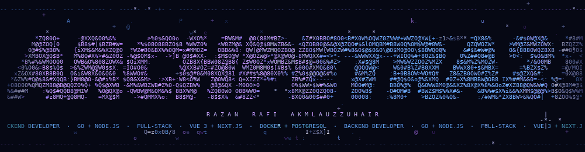
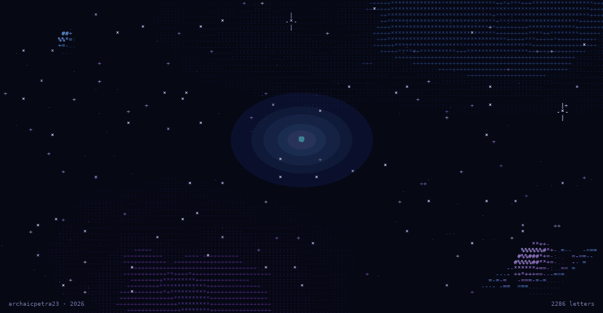

  

---

  

  
  
  

---

## Tentang Saya

Saya mahasiswa Teknologi Informasi di **Pradita University**, Tangerang, Indonesia. Fokus saya ada pada pengembangan backend dan aplikasi full-stack, dengan perhatian khusus pada arsitektur yang bersih, pengujian yang terstruktur, dan dokumentasi yang jelas.

Proyek-proyek saya banyak berangkat dari kebutuhan domain nyata, seperti sistem informasi rumah sakit dan pengelolaan klaim BPJS Kesehatan, sehingga saya terbiasa menangani alur bisnis yang kompleks, kontrol akses berbasis peran, dan integritas data.

---

## Tech Stack

<h4 align="center">Bahasa dan Framework</h4>

  

<h4 align="center">Database dan ORM</h4>

  

<h4 align="center">DevOps dan Tools</h4>

  

---

## Proyek Unggulan

### Nexa

**Platform Casemix dan Manajemen Klaim BPJS Kesehatan untuk Rumah Sakit**

Nexa menyatukan alur pelayanan dan penagihan klaim rumah sakit dalam satu platform. Sistem ini menghubungkan pendaftaran, dokter DPJP, perawat, koder Casemix, dan bagian keuangan, sehingga proses dari kunjungan pasien hingga pengajuan klaim BPJS dapat dipantau, ditelusuri, dan dikendalikan secara terpusat.

**Kapabilitas utama**

- **Alur kerja multi-peran**: setiap unit memiliki antarmuka dan hak akses sesuai tanggung jawabnya, dari pendaftaran hingga verifikasi keuangan
- **Manajemen klaim terpusat**: pelacakan status klaim dari awal hingga akhir dalam satu dashboard
- **Keamanan dan akuntabilitas**: Role-Based Access Control dan audit log untuk setiap aktivitas penting
- **Teruji pada data skala besar**: dataset simulasi dengan lebih dari 47 ribu pasien dan distribusi status klaim yang realistis
- **Siap dijalankan di mana saja**: seluruh layanan terkontainerisasi dengan Docker Compose
- **Terdokumentasi dengan baik**: PRD, coding style, DevLog, dan desain UI tersedia lengkap di repository

**Arsitektur**

| Lapisan | Teknologi |
|---------|-----------|
| Backend | Go, Gin, GORM |
| Database | PostgreSQL |
| Frontend | Vue 3, Vite, Pinia, PrimeVue |
| Infrastruktur | Docker, Docker Compose |

[Lihat repository](https://github.com/archaicpetra23/Nexa)

### Casemix-Website

**Hospital Management Information System untuk Rekam Medis dan Klaim BPJS**

Casemix-Website adalah sistem informasi rumah sakit berbasis web yang memusatkan data pasien, rekam medis, dan proses klaim BPJS dalam satu antarmuka. Sistem ini membantu tim rekam medis dan koder Casemix bekerja lebih cepat dan konsisten, sekaligus memberi manajemen gambaran real-time atas status klaim rumah sakit.

**Kapabilitas utama**

- **Manajemen pasien dan rekam medis terpadu**: data klinis tersimpan terstruktur dengan kodefikasi diagnosis ICD-10 dan prosedur ICD-9 CM
- **Monitoring klaim INA-CBGs**: pemantauan status dan perkembangan klaim secara langsung
- **Dashboard real-time**: ringkasan operasional dan klaim untuk pengambilan keputusan yang lebih cepat
- **Keamanan dan akuntabilitas**: Role-Based Access Control serta panel admin dengan audit log
- **Deployment praktis**: dijalankan dengan Docker dan dipublikasikan melalui Cloudflare Tunnel menggunakan skrip `start.sh` dan `stop.sh`

**Arsitektur**

| Lapisan | Teknologi |
|---------|-----------|
| Aplikasi | Next.js 14 (App Router), TypeScript |
| ORM | Prisma |
| Database | MySQL |
| Infrastruktur | Docker, Cloudflare Tunnel |

[Lihat repository](https://github.com/archaicpetra23/Casemix-Website)

---

## Statistik GitHub

  
  

  

---

## Kontak

Terbuka untuk kolaborasi proyek, magang, maupun diskusi teknis. Silakan hubungi melalui [email](mailto:rafirazanakmaluzzuhair@gmail.com) atau buka diskusi langsung di repository proyek saya.
